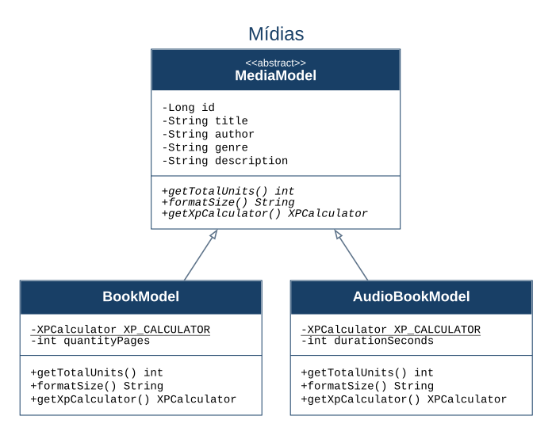
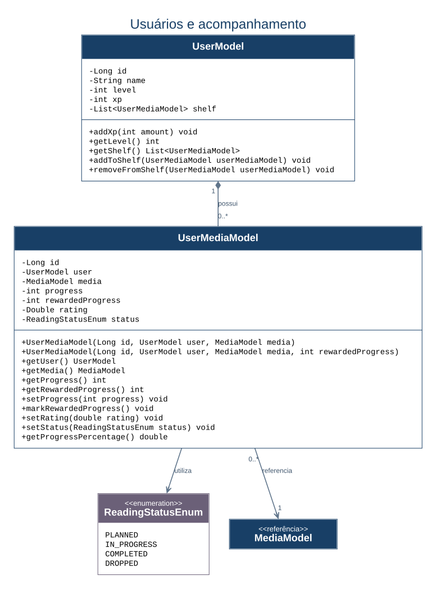
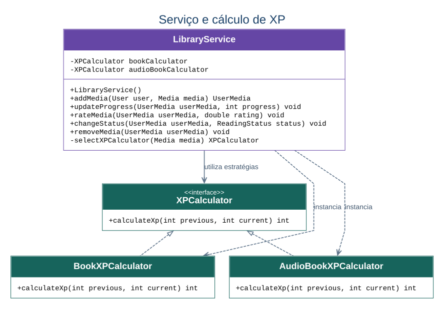
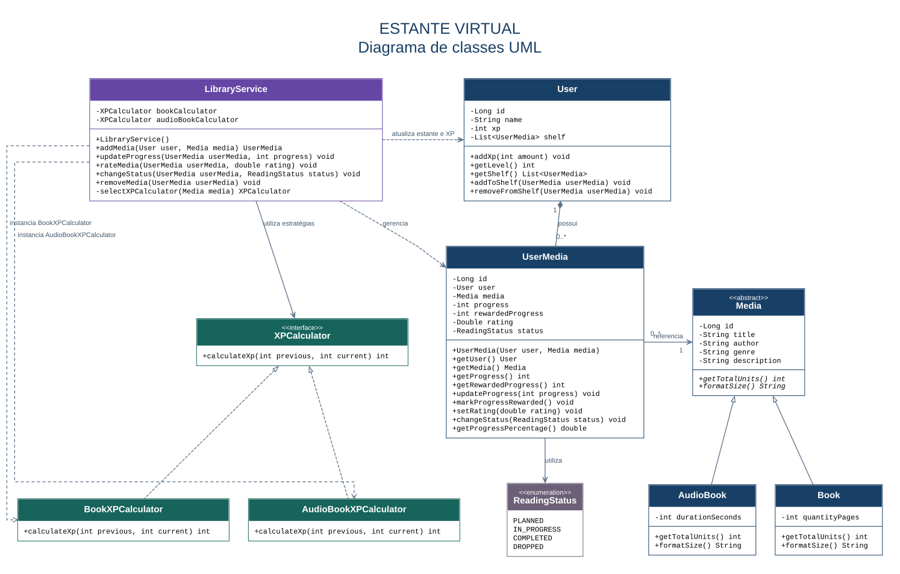

# 📚 Estante Virtual — Sistema de Gerenciamento de Leituras

Projeto desenvolvido para a disciplina de **Linguagem de Programação II**, do Bacharelado em Tecnologia da Informação da Universidade Federal do Rio Grande do Norte (UFRN).

## 📖 Sobre o projeto

A **Estante Virtual** é uma aplicação em Java voltada ao gerenciamento de leituras, permitindo que usuários organizem e acompanhem livros e audiolivros em uma biblioteca pessoal.

O sistema também contará com elementos de gamificação, incentivando o progresso por meio do acúmulo de pontos de experiência (XP) e da evolução de níveis.

## ⚙️ Funcionalidades previstas

- Cadastro e gerenciamento de livros e audiolivros.
- Organização das mídias em uma estante pessoal.
- Registro do progresso de leitura ou escuta.
- Gerenciamento do status das mídias.
- Avaliação das mídias cadastradas.
- Sistema de XP e níveis baseado no progresso.
- Interface gráfica desenvolvida com Java Swing.

## 🛠️ Tecnologias

| Tecnologia | Utilização |
|---|---|
| Java | Desenvolvimento da aplicação |
| Java Swing | Interface gráfica |
| Git e GitHub | Versionamento e colaboração |
| VS Code / IntelliJ IDEA | Ambiente de desenvolvimento |
| Assert (Java) | Testes unitários iniciais |
| SQLite ou arquivos locais | Persistência de dados (em avaliação) |

## 🏗️ Arquitetura e conceitos de POO

O projeto busca aplicar os principais conceitos de Programação Orientada a Objetos, incluindo abstração, encapsulamento, herança, polimorfismo e interfaces.

### Modelagem inicial

- **`Media`**: classe abstrata responsável pelas características e comportamentos comuns às mídias.
- **`Book`**: representa livros e suas características específicas.
- **`AudioBook`**: representa audiolivros e suas características específicas.
- **`User`**: representa os usuários e suas informações.
- **`UserMedia`**: gerencia o relacionamento entre usuários e mídias, incluindo progresso, avaliação e status.

### Diagrama de classes UML

O diagrama apresenta as classes principais, seus relacionamentos e as estratégias de cálculo de XP. Para facilitar a leitura, a visualização abaixo está dividida em três partes, em formato vetorial.

[Abrir diagrama completo em SVG](docs/uml/diagrama-de-classes.svg) · [Abrir PNG em alta resolução](docs/uml/diagrama-de-classes.png) · [Código Mermaid](docs/uml/diagrama-de-classes.mmd)

#### Mídias



#### Usuários e acompanhamento

A classe `Media` aparece como referência nesta parte; seus atributos e métodos estão na visualização de mídias acima.



#### Serviço e cálculo de XP

O `LibraryService` coordena as operações sobre `User` e `UserMedia` e utiliza as estratégias abaixo para calcular XP. Todas as relações entre essas classes estão no diagrama completo.



<details>
<summary>Visualizar o diagrama completo</summary>



</details>

### Padrão de projeto — Strategy

Para o cálculo de XP, será utilizado o padrão **Strategy**, por meio da interface `XPCalculator` e de duas implementações:

- **`BookXPCalculator`**: cálculo de XP baseado no progresso de leitura.
- **`AudioBookXPCalculator`**: cálculo de XP baseado no progresso de escuta.

Essa abordagem permite utilizar diferentes algoritmos de forma polimórfica, mantendo as regras de gamificação separadas das entidades de mídia.

## 📁 Estrutura de pastas

```text
Estante-Virtual/
├── src/
│   ├── main/
│   │   └── java/
│   │       └── estantevirtual/
│   │           ├── EstanteVirtual.java
│   │           ├── model/
│   │           ├── service/
│   │           ├── strategy/
│   │           └── view/
│   └── test/
│       └── java/
│           └── estantevirtual/
│               ├── model/
│               ├── service/
│               └── strategy/
├── docs/
│   └── uml/
└── README.md
```

| Pasta | Responsabilidade |
|---|---|
| `src/main/java/estantevirtual/model` | Classes de usuários, mídias e acompanhamento de leitura. |
| `src/main/java/estantevirtual/service` | Coordenação das operações da estante. |
| `src/main/java/estantevirtual/strategy` | Interface e implementações do cálculo de XP. |
| `src/main/java/estantevirtual/view` | Janelas e componentes da interface Swing. |
| `src/test/java/estantevirtual` | Testes organizados conforme os pacotes das classes. |
| `docs/uml` | Diagramas UML do projeto. |

O arquivo [EstanteVirtual.java](src/main/java/estantevirtual/EstanteVirtual.java) é o ponto de entrada da aplicação. Atualmente, ele declara o pacote `estantevirtual` e o método `main`, ainda sem as operações de inicialização do sistema.

As pastas de pacotes e testes ainda estão vazias. O Git passa a versioná-las quando seus primeiros arquivos forem adicionados.

## 🚀 Instalação e execução

O projeto está em fase inicial de desenvolvimento.

As instruções de compilação e execução, incluindo a versão do JDK e os comandos `javac` e `java`, serão disponibilizadas após a definição da estrutura e das dependências da aplicação.

## 📌 Status do projeto

**Em desenvolvimento — Etapa de planejamento e modelagem.**

As próximas etapas incluem o refinamento do diagrama UML, a implementação das classes principais, a definição do mecanismo de persistência, o desenvolvimento da interface gráfica e a elaboração dos testes.

## 👥 Desenvolvedores

- **Acírio Gabriel Ferreira Barbosa**
- **Gabriel Augusto Gomes Pinheiro**

**Instituição:** Universidade Federal do Rio Grande do Norte (UFRN)

**Disciplina:** Linguagem de Programação II
